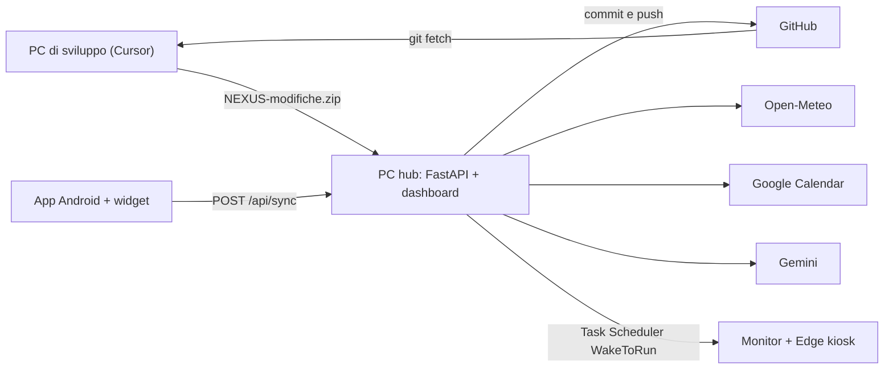

# NEXUS (Daily Hub)

Una schermata sulla giornata (meteo, eventi di Google Calendar, task e l'assistente Lilith) su un PC Windows sempre acceso, più un'app Android con tre widget che funziona anche senza PC. Il PC si riattiva all'ora della sveglia del telefono e mostra la dashboard a schermo intero.

Tutto gratuito: Open-Meteo, Google Calendar API (senza fatturazione), Gemini (piano gratuito), GitHub, APK installato in sideload.

Per gli agenti AI (Cursor, Claude Code, Codex, Copilot, Gemini): istruzioni in [AGENTS.md](AGENTS.md), base di conoscenza in [okf/](okf/index.md).



## Struttura

| Cartella | Contenuto |
| :-- | :-- |
| `hub-server/` | server FastAPI, SQLite, client per meteo, calendario e Gemini, dashboard in `static/` |
| `scripts/windows/` | installazione, avvio, riattivazione, kiosk, zip delle modifiche e build dell'APK |
| `android-app/` | app Kotlin con tre widget Glance |
| `docs/` | guide di setup |
| `okf/` | base di conoscenza per gli agenti AI |
| `aidlc-docs/` | requisiti, progetto e registro delle richieste (AI-DLC) |

## Flusso di lavoro fra i due PC

Il PC di sviluppo è dietro la rete aziendale: legge da GitHub ma non può fare push. Le modifiche arrivano sull'hub in uno zip e il push lo fa l'hub.

1. **PC di sviluppo** (questo): modifiche con Cursor e test, poi `scripts\windows\build_zip.ps1` crea `NEXUS-modifiche.zip` con i file cambiati rispetto a GitHub.
2. **PC hub**: trascina lo zip su `scripts\windows\applica_modifiche.bat`, oppure fai doppio clic per prendere il più recente in Download. Lo script applica i file, fa il commit `NEXUS <versione>`, il push su GitHub e riavvia NEXUS. Dettagli nella sezione 6 di [docs/windows-setup.md](docs/windows-setup.md).
3. **Telefono**: `scripts\windows\build_apk.ps1` compila `NEXUS-<versione>.apk` sul PC di sviluppo, da installare in sideload: vedi [docs/android-setup.md](docs/android-setup.md).

Le modifiche arrivate su GitHub senza uno zip (da un altro PC o da una pull request) vanno prima portate sul PC di sviluppo: finché mancano, `build_zip.ps1` non crea lo zip e l'hub rifiuta uno zip che le annullerebbe. Come recuperarle: [okf/procedure/consegna-zip.md](okf/procedure/consegna-zip.md).

## Repo su GitHub

Il repo è [CerroneDonato/NEXUS](https://github.com/CerroneDonato/NEXUS). Sul PC hub, la prima volta:

```powershell
cd $HOME
git clone https://github.com/CerroneDonato/NEXUS.git ADayInALife
```

Per l'autenticazione basta Git Credential Manager, incluso in Git for Windows.

## Guide

1. [Setup PC Hub (Windows)](docs/windows-setup.md)
2. [Collegare Google Calendar](docs/google-calendar-setup.md)
3. [Rete: Tailscale o LAN](docs/network-setup.md)
4. [App Android e widget](docs/android-setup.md)
5. [Verifica end-to-end](docs/e2e-check.md)
6. [Assistente Lilith (Gemini gratuito)](docs/assistant-setup.md)
7. [Modalità sport](docs/sport-mode.md)

## Sviluppo locale

```powershell
cd hub-server
py -3 -m venv .venv
.\.venv\Scripts\python.exe -m pip install -r requirements-dev.txt
.\.venv\Scripts\python.exe -m pytest
# server di prova (senza wake): crea .env da .env.example, poi
.\.venv\Scripts\python.exe run.py
```

## API

Con il server acceso, l'elenco aggiornato delle rotte è su `http://localhost:8765/docs`. Tutte le rotte `/api/*`, tranne `/api/health`, richiedono `Authorization: Bearer <HUB_API_TOKEN>`. Le principali sono descritte in [okf/componenti/hub-server.md](okf/componenti/hub-server.md).
