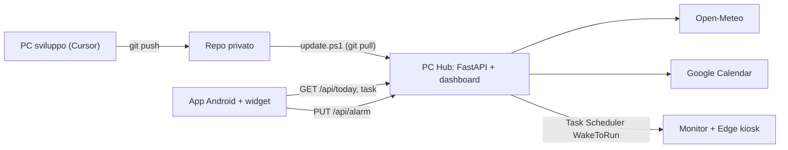

# Daily Hub

Una schermata sulla giornata (meteo di Milano, eventi di Google Calendar, task personali), su un PC Windows sempre acceso e in un widget Android. Il PC si riattiva all'ora della sveglia del telefono e mostra la dashboard a schermo intero.

Tutto gratuito: Open-Meteo, Google Calendar API (senza fatturazione), Tailscale Personal, GitHub privato, APK installato in sideload.



## Struttura

| Cartella | Contenuto |
| :-- | :-- |
| `hub-server/` | API FastAPI, SQLite, client meteo/calendario, dashboard in `static/` |
| `scripts/windows/` | installazione, aggiornamento, riattivazione e kiosk |
| `android-app/` | app Kotlin con widget Glance e sincronizzazione sveglia |
| `docs/` | guide di setup |
| `aidlc-docs/` | documentazione del processo AI-DLC |

## Flusso di lavoro fra i due PC

1. **PC di sviluppo** (questo): modifiche con Cursor, test, `git push`.
2. **PC Hub**: `scripts\windows\update.ps1` (a mano o ogni notte) fa `git pull` e riavvia il server.
3. **Telefono**: l'APK si compila con Android Studio e si installa in sideload.

### Repo remoto (una volta sola)

Crea un repository **privato** vuoto su [GitHub](https://github.com/new) (gratuito), poi dal PC di sviluppo:

```powershell
git remote add origin https://github.com/<utente>/daily-hub.git
git push -u origin main
```

Sul PC Hub: `git clone https://github.com/<utente>/daily-hub.git` (per l'autenticazione usa Git Credential Manager, incluso in Git for Windows).

## Guide

1. [Setup PC Hub (Windows)](docs/windows-setup.md)
2. [Collegare Google Calendar](docs/google-calendar-setup.md)
3. [Rete: Tailscale o LAN](docs/network-setup.md)
4. [App Android e widget](docs/android-setup.md)
5. [Verifica end-to-end](docs/e2e-check.md)
6. [Assistente Lilith (Gemini gratuito)](docs/assistant-setup.md)

## Sviluppo locale

```powershell
cd hub-server
py -3 -m venv .venv
.\.venv\Scripts\python.exe -m pip install -r requirements-dev.txt
.\.venv\Scripts\python.exe -m pytest
# server di prova (senza wake): crea .env da .env.example, poi
.\.venv\Scripts\python.exe run.py
```

## API

Tutte le rotte `/api/*` (tranne `/api/health`) richiedono `Authorization: Bearer <HUB_API_TOKEN>`.

| Metodo | Rotta | Descrizione |
| :-- | :-- | :-- |
| GET | `/api/today` | meteo, eventi di oggi, task aperti, sveglia |
| GET | `/api/tasks?includeDone=false` | elenco task |
| POST | `/api/tasks` | `{"title": "...", "due": "2026-11-12"}` |
| PATCH | `/api/tasks/{id}` | `{"done": true}` / `{"title": ...}` / `{"due": null}` |
| DELETE | `/api/tasks/{id}` | elimina |
| GET/PUT | `/api/alarm` | `{"nextAlarm": "2026-11-11T07:00:00+01:00"}` oppure `null` |
| GET | `/api/assistant` | `{"name": "Lilith", "enabled": true}` |
| POST | `/api/assistant/chat` | `{"conversationId": "...", "message": "..."}` -> `{"reply": "...", "actions": [...]}` |
| DELETE | `/api/assistant/chat/{conversationId}` | azzera la conversazione |
